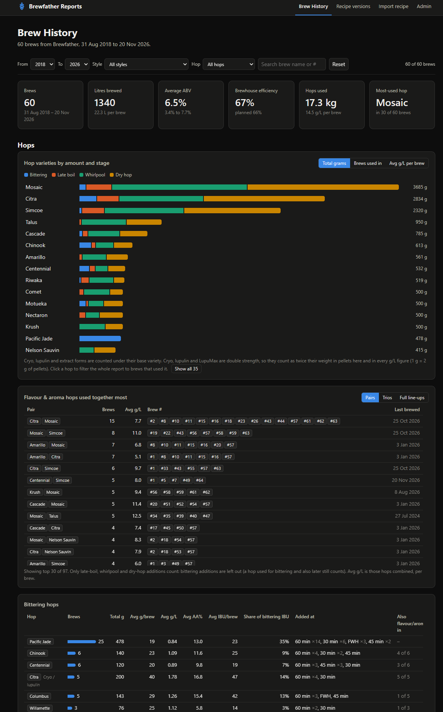

# Brewfather Reports

© 2026 Thinkbox · MIT licence · see [TERMS.md](TERMS.md). Not affiliated with or endorsed by Brewfather.

Reports on your own brewing history from your Brewfather account: hops, malt, water, results,
recipe versions and hop flavour charts. It runs on your own computer or server with your own
Brewfather API key, and your data stays there.



**New: runs as a desktop app.** One double-click (`install-app.bat` on Windows) gives it a Start Menu and
desktop shortcut with its own icon. It opens in its own window with no tabs or address bar, needs no server
window, and closes down by itself when you're done. In Edge or Chrome an **Install as app** button on the Admin
page also adds it to your apps. See [Desktop app](#desktop-app).

## Install

1. Install Python 3.9 or newer (python.org). Nothing else is needed: it uses only Python's standard library.
2. Unzip the package somewhere, for example `Documents/Brewfather Reports`.
3. Start it, either way:
   - **as a desktop app:** double-click `install-app.bat` (Windows) or run `./install-app.sh` (Linux) once, then open
     **Brewfather Reports** from the Start Menu, desktop or applications menu (see [Desktop app](#desktop-app)); or
   - **in a server window:** double-click `start.bat` (Windows), or run `./start.sh` (Mac/Linux), or `python app/server.py`,
     then open http://localhost:8642/admin.html.
4. The first time, the Admin page asks for:
   - the **setup code** (the desktop app fills it in; otherwise it's shown in the server window),
   - your **Brewfather User ID and API key** (Brewfather › Settings › API › Generate key; give it read access
     to batches and recipes),
   - an **admin password** for this site.

It then downloads your brews and builds the pages. If you used `start.bat`, keep the server window open while you use it.

## Desktop app

Brewfather Reports is a small web server plus pages, so the "app" is the server running quietly in the background
and a browser window with no tabs or address bar showing the pages. Nothing extra is installed: it uses the Python
you already have and the Edge or Chrome on your computer.

### Windows

1. Double-click **`install-app.bat`** in the Brewfather Reports folder. It adds:
   - **Brewfather Reports** to the Start Menu and your desktop, with the hop icon;
   - **Stop Brewfather Reports** to the Start Menu (in the Brewfather Reports folder);
   - a sign-in start, so the server is already running whenever you open the app.
     For the shortcuts without that, run `python app\desktop.py --install` instead.
2. Open **Brewfather Reports** from the Start Menu or desktop. It starts the server if it isn't running and opens
   the app window. The first time, the Admin page's setup code is already filled in.

Opening the shortcut twice is fine: it only ever starts one server, and otherwise just opens another window.

### Install as app (Edge or Chrome, Windows, Mac or Linux)

This puts Brewfather Reports with your other apps (Start Menu, taskbar pinning, Launchpad on a Mac) the way the
browser installs any web app.

- The easy way: open the **Admin** page in an ordinary Edge or Chrome window and click **Install as app** at the top.
  The button only shows in Edge and Chrome, and only while it isn't installed yet. Once the installed app has been
  opened, the server remembers it, so the button stays hidden in every browser: installed from Edge, viewed in Chrome,
  no button. If you uninstall the app, the button comes back after 60 days without it being opened.
- Or from the browser itself, at http://localhost:8642 in an ordinary window (not the app window, whose menu leaves it out):
  - the **install icon** at the right end of the address bar (a screen or square with a down arrow), or
  - **Edge:** **⋯** › **Apps** › **Install Brewfather Reports** (in some versions **Apps** is under **⋯** › **More tools**);
  - **Chrome:** **⋮** › **Cast, save, and share** › **Install Brewfather Reports…**

The installed app needs the server running. If it isn't, the app shows "Brewfather Reports isn't running" with a
Try again button: open the Brewfather Reports shortcut (or `start.bat` / `start.sh`), then try again.

### Linux and Mac

- **Linux:** run `./install-app.sh` to add Brewfather Reports to your applications menu (and start the server when
  you sign in). It opens in Chrome, Chromium, Edge or Brave if you have one, otherwise your default browser.
- **Mac:** run `./start.sh`, open http://localhost:8642 in Chrome or Edge and use **Install as app** (above). To have
  the server running whenever you open it, add `start.sh` to System Settings › General › Login Items.

### Closing it down

- **Just close the app window.** A server started by the shortcut closes down by itself about five minutes after
  the last Brewfather Reports window or tab is closed. It waits for a fetch or rebuild to finish first.
- **Stop Brewfather Reports** (Start Menu) closes it down straight away and says "Brewfather Reports is closed down."
  It stops the server however it was started: the shortcut, the sign-in start or `start.bat`.
  From a command line: `python app/desktop.py --stop`.
- The server from the sign-in start keeps running until you use Stop or sign out, so the app always opens straight away.

### Good to know

- **Task Manager:** the server is **Python** (`pythonw.exe`) under Background processes, using about 30–40 MB.
  The window is listed under **Microsoft Edge** (or Chrome), or under its own name once installed as an app.
- **Browser:** Edge is used first (every Windows 10 and 11 PC has it), then Chrome, Brave or Chromium. With none of
  those, it opens in your default browser as an ordinary tab, and everything still works.
- **Port:** 8642. The shortcut checks it first: if Brewfather Reports is already there it reuses it, and if another
  program has it you get a message instead of a clash. It never moves to another port by itself, because your
  sign-in and the installed app belong to that exact address. To use another port, run
  `python app\desktop.py --install --port 8643` and the shortcuts are rewritten for it.
- **Log:** the server's output (normally in its window) goes to `data/server.log`.
- **Remove the shortcuts:** `python app/desktop.py --uninstall`. To remove an app installed from the browser, right-click
  it in the Start Menu and choose Uninstall, or use the browser's Apps page (`edge://apps` or `chrome://apps`).

To run it on a public web server, including a Plesk VPS alongside other sites, see [docs/DEPLOY.md](docs/DEPLOY.md).

## Updating

New versions are published as releases on GitHub. Once a day, the Admin page asks GitHub whether there is a newer one,
and if so shows **Version x.y.z is available** at the top with what's new and a **Download** button. Only a plain
request for the latest version number goes to GitHub: nothing about you or your brews. Turn it off, or check
straight away with **Check now**, in Admin › Settings.

To update:

1. Close Brewfather Reports: **Stop Brewfather Reports** in the Start Menu, or close the `start.bat` window.
2. Download the new version's zip and unzip it **over** your Brewfather Reports folder, replacing the files. If you
   cloned it with git, run `git pull` in the folder instead.
3. Open Brewfather Reports again (the shortcut or `start.bat`).

Your brews, settings, admin password and keys (`data/` and `.env`) and your own `exclude.txt` and `families.txt` are
not in the zip, so they are kept. The desktop shortcuts keep working as long as the folder stays where it is.

## Pages

Every page has the same header with links to the others.

- **Brew History** (`report.html`)
  - **Hops:** amounts by stage (bittering, late boil, whirlpool, dry hop), and the flavour/aroma hop
    pairs, trios and full line-ups you use. Cryo, lupulin and LupuMax hops are double strength, so hop
    amounts, every g/L rate and the flavour charts count them as twice their weight in pellets. Recipe
    listings still show the grams you weighed, with the pellet equivalent beside them (e.g. "30 g (≈ 60 g
    pellets)"), and IBU comes from Brewfather unchanged.
  - **Bittering hops:** a table of usage, alpha acid, IBU and timing.
  - **Malt bill:** the make-up of each grist.
  - **Water:** your tap water profiles, final Ca/Mg/Cl/SO4 per brew, the SO4:Cl ratio (e.g. 5.5:1), planned
    vs measured mash pH, salts and acid per brew, and suggested salts for West Coast IPA, NEIPA and pale ale.
  - **Results:** planned vs actual ABV and efficiency, and attenuation.
  - **Brew log:** click a brew for its details and a hop flavour chart.
- **Recipe versions** (`versions.html`): what changed between brews of the same recipe, and how it turned out.
- **Import recipe** (`import.html`): paste a recipe from a magazine, book or web page and create it in Brewfather, scaled to your
  batch. See below.
- **Admin:** see below.
- **Terms:** copyright, licence and terms of use.

CSV files (`brews.csv`, `hops.csv`, `malts.csv`) can be downloaded from the Admin page.

## Admin page

- **New version:** when a newer version has been released, a card at the top says so, with what's new and a
  Download button. See [Updating](#updating).
- **Install as app:** shown in Edge and Chrome until the app is installed (in any browser). See [Desktop app](#desktop-app).
- **Data:** fetch from Brewfather and rebuild, rebuild from saved data, or update hop data. The progress log shows as it runs.
- **Brews in the reports:** untick a brew to leave it out (it is saved in `exclude.txt`). Brews with `#noreport` in a
  Brewfather batch note are always left out.
- **Settings:**
  - Site title.
  - Your tap water profile, used in the Water section.
  - Automatic fetching (every 1 to 24 hours, while the server runs).
  - Whether the report pages need a sign-in. They are private by default.
  - Check for new versions (on by default), with a **Check now** button.
- **Recipe families:** which brews belong together on the Recipe versions page (`families.txt`).
- **Extra hop flavours:** aroma scores for hops HopDatabase doesn't have (`hop_flavours_extra.json`).
- **Standard recipe for imports:** the Brewfather recipe that imported recipes are built on (your latest brew if you don't choose one).
- **AI recipe reader (optional):** connect Claude, ChatGPT, Gemini or Copilot with your own API key.
- **Brewfather connection:** test the connection, or change the User ID and API key.
- **Downloads:** the CSV files and a JSON backup of every batch.
- **Admin password:** change it, or sign out.

## Hop flavour charts

The charts use the aroma scores (Citrus, Resin/Pine, Spice, Herbal, Grassy, Floral, Berry, Stone Fruit,
Tropical Fruit, 0 to 5) from the [HopDatabase](https://github.com/kasperg3/HopDatabase) project, which
collects them from hop suppliers. A brew's chart averages its hops by grams:

- whirlpool and dry hops count in full,
- late-boil hops count half,
- bittering hops are left out.

**Save PNG for Brewfather** saves the chart as a 1000 × 1000 image to add to a recipe or batch in the
Brewfather app. Brewfather's API can't upload images.

## Import recipe

Paste a whole recipe (title, batch size, OG/FG/IBU, malts, hops, yeast, method) and click **Read recipe**.

1. **Reading.** By default the recipe is read on your own server. It understands metric and imperial amounts, US and imperial
   gallons, °F, tables copied from web pages, and BeerSmith/Brewfather-style printouts. Anything it can't settle becomes a question
   for you, with a recommended answer. Tick "Answer the questions for me" to take the recommended answers straight away.
2. **Following the recipe.** Every malt, hop addition and other addition is kept as written: same ingredients, stages, times and
   order. Nothing is swapped automatically. When you have used the very same ingredient before (same malt, same hop variety and
   form) and use it regularly, yours is used for its colour, potential or alpha acid. Otherwise each malt becomes a question:
   your malts of the same kind are offered most-used first (for pale two-row: your pilsner and ale malts), with "keep as written"
   and a list of every malt you've used. You can swap any ingredient from the menu under it, which lists every malt and hop from
   your past brews (same kind or variety first, then A–Z). Swapping between pellets and cryo /
   lupulin halves or doubles the weight; swapping a bittering hop for another variety also corrects for alpha acid. The yeast is matched by strain or family (for example WLP001 or "a Chico strain" → your US-05), as a question.
3. **Scaling to your batch.**
   - Hops and other additions (finings, liquid hop products and so on) are multiplied by your batch size ÷ the recipe's.
   - Grain gets the same volume factor plus an efficiency correction, so it still reaches the recipe's OG at your efficiency.
     If the recipe has no OG, its efficiency (or 72%) is used.
   - The review shows each amount as recipe → scaled → change. Click **edit** to set one yourself.
   - Bitterness: hops are scaled as written by default. "Adjust bittering" scales the bittering additions to hit the recipe's IBU.
   - Hop times are kept as written; if they're longer than your boil you're told to lengthen it in Brewfather.
   - Numbered dry hops ("first/second/third dry hop") without days become a question about which days.
   - Hop totals are shown in 100 g bags. Water salts and priming sugar from the recipe aren't added: your water standards apply.
4. **Your standards.** Equipment, mash, fermentation, folder and usual yeast come from your standard recipe (Admin page). For
   water you can keep your standard salts, or get salts worked out for West Coast IPA, NEIPA or pale ale on your own water.
5. **Review and create.** Every match and amount can be changed. **Create in Brewfather** adds it as a new recipe; it never
   changes your existing recipes. The Brewfather API key needs permission to edit recipes.

**Optional AI reader.** On the Admin page you can connect Claude (Anthropic), ChatGPT (OpenAI), Gemini (Google) or Copilot (GitHub
Models, or your own Azure OpenAI deployment) with your own API key. The model and API address can be changed; a local model server
on `http://localhost` with an OpenAI-style API also works under "Copilot". The AI reads the recipe and picks your matching
ingredients, and the same questions and review follow. Without a key, **Copy a prompt for my own chat AI** gives you a prompt to
paste into any chat AI in your browser; paste its JSON answer back into the box and click Read recipe.

## Command line

```
python app/server.py              # the web server (Admin page and reports); start.bat / start.sh run this
python app/desktop.py             # start the server in the background and open the app window
python app/desktop.py --install   # Start Menu and desktop shortcuts (add --autostart to start at sign-in)
python app/desktop.py --stop      # close down Brewfather Reports however it was started (--uninstall removes the shortcuts)
python app/server.py --idle-exit 300   # stop when no page has been open for 5 minutes (the shortcut uses this)
python app/run.py                 # fetch from Brewfather and build the pages without the server
python app/run.py --offline       # rebuild from the saved data
python app/run.py --update-hops   # download the latest HopDatabase hop data first
```

## Folders

| Folder or file | What it is |
|---|---|
| `start.bat`, `start.sh` | Start the server (Windows, Mac/Linux). |
| `install-app.bat`, `install-app.sh` | Install it as a desktop app (see Desktop app). |
| `app/` | The Python program. `paths.py` says where everything lives. |
| `templates/` | The page templates (Brew History, Recipe versions, Import recipe, Admin, Terms), the hop chart script, the app icons and the service worker for installing it as an app. |
| `config/` | Files you edit, also editable on the Admin page: `exclude.txt` (brews left out), `families.txt` (recipe families), `hop_flavours_extra.json` (extra hop flavours). |
| `hopdata/` | Hop aroma data from HopDatabase (MIT licence). |
| `docs/` | Running it on a public web server ([DEPLOY.md](docs/DEPLOY.md)). |
| `tools/` | Building the installable package, and drawing the app icon (`make_icons.py`). |
| `.env` | Your Brewfather User ID and API key, and any AI reader key (written by the Admin page). Keep it private. |
| `data/` | Downloaded brews, settings and the admin password hash. Back it up; never share it. |
| `output/` | The built pages. |

Colours are shown in EBC (Brewfather stores SRM; EBC = SRM × 1.97).

## Building the package

`python tools/build_package.py` writes `dist/brewfather-reports-<version>.zip`. It leaves out `.env`, `data/`,
`output/`, your `exclude.txt` and `families.txt`, and any local add-ons. The version number is in `app/version.py`.

To release a version: raise `VERSION` in `app/version.py`, build the package, then publish a GitHub release whose tag is
the version (for example `v1.3.0`) with the zip attached:
`gh release create v1.3.0 dist/brewfather-reports-1.3.0.zip --title "1.3.0" --notes "What's new…"`.
The Admin page's update check reads the latest release, so it needs the repository (or its releases) to be public.


## Shutting app down

If you use the desktop app, see [Closing it down](#closing-it-down): close the window, or use **Stop Brewfather Reports**.

If you started it with start.bat:

Click in the cmd window where the server is running and press Ctrl+C. The server stops, and the window shows “Press any key to continue”. Press any key to close it.

You can also just close the cmd window with its X. Nothing is lost, because your data and settings are already saved in the folder.

Some things to know:

If you close it while a fetch or rebuild is running, that run is cut short. Click the button again next time.
Automatic fetching only happens while the server is running.
To look at your history again, double-click start.bat and open http://localhost:8642. You’ll only need your admin password; the setup code was for the first time.